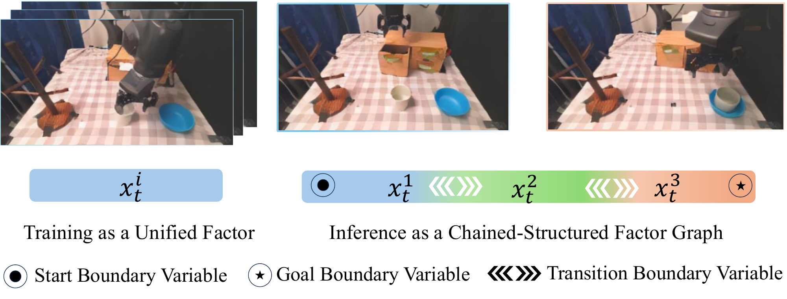

# Compositional Visual Planning via Inference-Time Diffusion Scaling

[[Project page]](https://comp-visual-planning.github.io/)
[[Paper]](https://arxiv.org/pdf/2603.02646)
[[arXiv]](https://arxiv.org/abs/2603.02646)
[[Hugging Face]](https://huggingface.co/comp-visual-planning/models)

[Yixin Zhang](https://yzhang4179.github.io/)<sup>1</sup>,
[Yunhao Luo](https://devinluo27.github.io/)<sup>1, 2</sup>,
[Utkarsh Mishra](https://umishra.me/)<sup>1</sup>,
[Woo Chul Shin](https://woocshin.github.io/profile/)<sup>1</sup>,
[Yongxin Chen](https://yongxin.ae.gatech.edu/)<sup>1</sup>,
[Danfei Xu](https://faculty.cc.gatech.edu/~danfei/)<sup>1</sup>

<sup>1</sup>Georgia Tech,
<sup>2</sup>University of Michigan

This is the official implementation of "*Compositional Visual Planning via Inference-Time Diffusion Scaling*". For each task, we train a diffusion model on short video clips of 16 frames, encoded with the Cosmos image tokenizer. To plan from a start image to a goal image, the model generates several overlapping chunks and denoises them together. At every denoising step, our method guides the Tweedie estimates of neighboring chunks to agree where they meet, so the chunks join into one long plan. An inverse dynamics model then turns the planned frames into robot actions. The four manipulation tasks are simulated in SAPIEN and described in [`env/README.md`](env/README.md).

<p align="center">
  
</p>

## 🛠️ Getting Started

```bash
git clone https://github.com/yzhang4179/comp_visual_planning_release.git
cd comp_visual_planning_release
conda create -n cvp python=3.10
conda activate cvp
pip install torch==2.2.1 --index-url https://download.pytorch.org/whl/cu121
pip install -e .
```

The simulator renders with Vulkan, so it needs an NVIDIA driver with Vulkan support.

The hyper-parameters are in [`configs/config.yaml`](configs/config.yaml) and the per-task files [`configs/env/<task>.yaml`](configs/env). Pick the task with `env=<task>` (`cube`, `drawer`, `puzzle` or `tool`) and override any value with [Hydra](https://hydra.cc/) syntax, e.g. `python eval.py env=puzzle start=2 goal=5 num_episodes=1`. Paths in the configs are relative to the repository root, so run the scripts from there.

## 📊 Using Pretrained Models

The checkpoints used in the paper are on the Hugging Face Hub at [comp-visual-planning/models](https://huggingface.co/comp-visual-planning/models). `eval.py` downloads the files of a task into `ckpts/` when they are missing, so you can run inference right away. To download them by hand:

```bash
hf download comp-visual-planning/models --local-dir ckpts                                          # everything (about 10 GB)
hf download comp-visual-planning/models --include "cube/*" --include "cosmos/*" --local-dir ckpts  # one task
```

| File | Description | Size |
| --- | --- | --- |
| `cube/diffusion_100000.ckpt` | planner for cube: DiT (16 blocks, width 1024) | 2.5 GB |
| `drawer/diffusion_460000.ckpt` | planner for drawer: DiT (16 blocks, width 1024) | 2.5 GB |
| `puzzle/diffusion_60000.ckpt` | planner for puzzle: DiT (24 blocks, width 1024) | 3.7 GB |
| `tool/diffusion_220000.ckpt` | planner for tool: DiT (12 blocks, width 768) | 1.0 GB |
| `<task>/invdyn_<step>.ckpt` | inverse dynamics model, predicts the action between two latent frames | 1.3 MB |
| `<task>/actions_minmax.json` | min and max of each action dimension, used to normalize the actions | < 1 KB |
| `cosmos/Cosmos-Tokenizer-CI16x16/` | encoder and decoder of NVIDIA's [Cosmos-0.1-Tokenizer-CI16x16](https://huggingface.co/nvidia/Cosmos-0.1-Tokenizer-CI16x16), unmodified, with their license | 163 MB |

Each planner file holds the online and the EMA weights (`model` and `model_ema`).

## 🏃‍♂️ Inference

```bash
python eval.py env=cube method=cvp start=1 goal=2
```

This runs the 30 evaluation episodes of one start-goal pair; add `num_episodes=1` for a quick check. In each episode, the environment renders the start and goal images from the states stored in [`env/eval_states/`](env/eval_states). The planner generates the frames between them, the inverse dynamics model turns the frames into actions, and the robot executes the actions from the start state. The outputs go to `outputs/cvp/<task>/start_<s>_goal_<g>/seed_<k>/`:

- `plans/ep<i>_success_<0|1>.mp4`: the decoded plan
- `rollouts/ep<i>_success_<0|1>.mp4`: the executed rollout
- `metrics.json`: success and planning time of every episode, and their averages

The paper runs every start-goal pair (4 x 4 for cube and drawer, 8 x 8 for puzzle, 2 x 2 for tool) with seeds 0, 1 and 2. For cube:

```bash
for start in 0 1 2 3; do for goal in 0 1 2 3; do for seed in 0 1 2; do
  python eval.py env=cube start=$start goal=$goal seed=$seed
done; done; done
```

The guidance uses three losses. The forward loss pulls the first frames of each chunk toward the end of the previous chunk, or toward the start image for the first chunk. The backward loss pulls the last frames toward the beginning of the next chunk, or toward the goal image. The sync loss penalizes all boundary mismatches at once. Each task config sets the weight `w_sync` and the form `sync_loss` of the sync loss. `discount` decays the forward and backward losses with the distance from the start and goal, and `wg` is the share of the guidance direction in the noise of each stochastic DDIM step. See `CVP.cvp_sample` in [`cvp/diffusion/cvp.py`](cvp/diffusion/cvp.py) for details.

Evaluation always uses the raster renderer, since the models were trained on raster images. [`env/README.md`](env/README.md) shows how to render the scenes with ray tracing for nicer videos.

## 📔 Baselines

```bash
python eval.py env=cube method=gsc start=1 goal=2
```

This runs the baseline (`CVP.gsc_sample`) with the same checkpoints and chunks and writes to `outputs/gsc/`. Following [DiffCollage](https://arxiv.org/abs/2303.17076), it averages the overlapping frames of neighboring chunks after every deterministic DDIM step and writes the start and goal frames back. [Generative Skill Chaining (GSC)](https://arxiv.org/abs/2401.03360) extends the same formulation to robot task-and-motion planning as DiffCollage follow-up work, which is where the sampler gets its name.

## 🚀 Training

```bash
torchrun --standalone --nproc_per_node=4 train_planner.py env=cube
python train_invdyn.py env=cube
```

## 🙏 Acknowledgement
* The implementation of DDPM and DiT is adapted from [CleanDiffuser](https://github.com/CleanDiffuserTeam/CleanDiffuser) (Apache-2.0).
* Images are encoded with NVIDIA's [Cosmos-0.1-Tokenizer-CI16x16](https://huggingface.co/nvidia/Cosmos-0.1-Tokenizer-CI16x16), licensed by NVIDIA Corporation under the [NVIDIA Open Model License](https://developer.download.nvidia.com/licenses/nvidia-open-model-license-agreement-june-2024.pdf).
* The environments are built on [SAPIEN](https://github.com/haosulab/SAPIEN), with code adapted from [ManiSkill](https://github.com/haosulab/ManiSkill) and [RoboTwin](https://github.com/RoboTwin-Platform/RoboTwin), and a cabinet model from PartNet-Mobility ([SAPIEN paper](https://arxiv.org/abs/2003.08515)). See [`env/README.md`](env/README.md) for details.
* Files adapted from these projects, listed in [`THIRD_PARTY_LICENSES.md`](THIRD_PARTY_LICENSES.md), keep their licenses; the rest of the code is MIT.

Contact [Yixin Zhang](mailto:yzhang4179@gatech.edu) if you have any questions or suggestions.

## 📝 Citations
If you find our work useful, please consider citing:
```bibtex
@misc{zhang2026compositionalvisualplanninginferencetime,
      title={Compositional Visual Planning via Inference-Time Diffusion Scaling},
      author={Yixin Zhang and Yunhao Luo and Utkarsh Aashu Mishra and Woo Chul Shin and Yongxin Chen and Danfei Xu},
      year={2026},
      eprint={2603.02646},
      archivePrefix={arXiv},
      primaryClass={cs.RO},
      url={https://arxiv.org/abs/2603.02646},
}
```
