# 🤖 Environments

The four tasks of the paper (cube, drawer, puzzle and tool) are built on [SAPIEN](https://github.com/haosulab/SAPIEN) ([paper](https://arxiv.org/abs/2003.08515)). Each task has a Franka Panda arm on a table and one 256x256 camera. An action is a target end-effector pose plus a gripper command, `[x, y, z, qw, qx, qy, qz, gripper]`, and the [mplib](https://github.com/haosulab/MPlib) motion planner moves the arm there.

| Task | Starts | Goals | Description |
| --- | :---: | :---: | --- |
| `cube` | 4 | 4 | The robot sorts four cubes onto their own corner landmarks and then assembles them into goal poses. |
| `drawer` | 4 | 4 | The robot picks up a brush from the cabinet or the table, draws a character on the canvas, and closes both drawers. |
| `puzzle` | 8 | 8 | The robot sorts four puzzle pieces onto their own corner landmarks and then assembles them into goal poses. |
| `tool` | 2 | 2 | A cube starts on the rack or on the table. The robot places it on the target, or pushes it under the rack with an L-shaped hook. |

```python
from env import ENVS, load_eval_states

env = ENVS["cube"](start=1, goal=2, recording=True, headless=True)
states = load_eval_states("cube")  # 30 evaluation episodes
goal = states["ep0"]["goal_2"]
goal_img = env.render_state(goal["state"], start=goal["render_start"], goal=2)
obs = env.reset(start=1, goal=2, initial_states=states["ep0"]["start_1"]["state"])
action = ...  # (8,): end-effector position, quaternion (w, x, y, z), gripper (1 open, -1 closed)
obs, reward, done, info = env.step(action)  # reward is 1 once the task is solved
```

`eval_states/<task>.json` holds the start and goal states of the 30 evaluation episodes, e.g. `states["ep3"]["goal_0"]["state"]`. `eval.py` renders the start and goal images from these states, plans between them, and executes the plan from the start state.

## Rendering

By default the scenes are rendered with the rasterizer (`enable_rt=False`), which is fast and light on GPU memory. Our models were trained on these images, so `eval.py` always uses it. `enable_rt=True` switches to SAPIEN's ray tracer with its own lights (32 samples per pixel, OptiX denoiser). We use it only to make nicer videos, and it needs a GPU with RT cores, such as an L40S or RTX 6000. The physics and the camera are the same in both modes, so the same actions give the same rollout.

```python
env = ENVS["drawer"](recording=True, enable_rt=True)
```

## Example tasks

Policy rollouts of our planner, rendered with ray tracing.

| | | | |
| :---: | :---: | :---: | :---: |
| 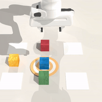<br>start 0, goal 1 | 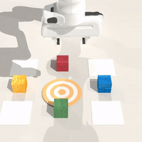<br>start 1, goal 2 | 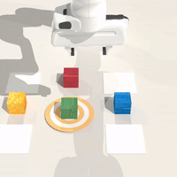<br>start 2, goal 3 | 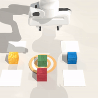<br>start 3, goal 0 |
| 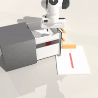<br>start 0, goal 1 | 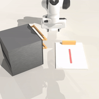<br>start 1, goal 2 | 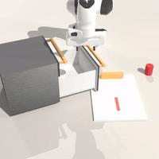<br>start 2, goal 3 | 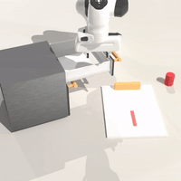<br>start 3, goal 0 |
| 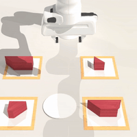<br>start 0, goal 3 | 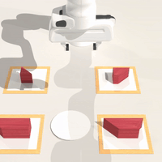<br>start 2, goal 5 | 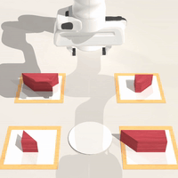<br>start 4, goal 1 | 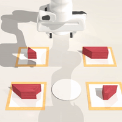<br>start 6, goal 7 |
| 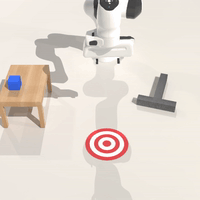<br>start 0, goal 0 | <br>start 0, goal 1 | 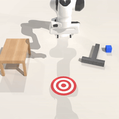<br>start 1, goal 0 | <br>start 1, goal 1 |

## 🙏 Acknowledgement
* The simulation is built on [SAPIEN](https://github.com/haosulab/SAPIEN).
* The Panda robot is adapted from [ManiSkill](https://github.com/haosulab/ManiSkill) (Apache-2.0): its model in `assets/panda/`, `panda.py`, `controllers/` and the URDF helpers in `utils/utils.py`.
* The actor helpers in `utils/actor_utils.py` and `utils/create_actor.py` are adapted from [RoboTwin](https://github.com/RoboTwin-Platform/RoboTwin) (MIT).
* The cabinet of the drawer task comes from PartNet-Mobility, the articulated-object dataset released with [SAPIEN](https://arxiv.org/abs/2003.08515), and is subject to its terms of use.

```bibtex
@InProceedings{Xiang_2020_SAPIEN,
    author = {Xiang, Fanbo and Qin, Yuzhe and Mo, Kaichun and Xia, Yikuan and Zhu, Hao and Liu, Fangchen and Liu, Minghua and Jiang, Hanxiao and Yuan, Yifu and Wang, He and Yi, Li and Chang, Angel X. and Guibas, Leonidas J. and Su, Hao},
    title = {{SAPIEN}: A SimulAted Part-based Interactive ENvironment},
    booktitle = {The IEEE Conference on Computer Vision and Pattern Recognition (CVPR)},
    month = {June},
    year = {2020}
}
```
